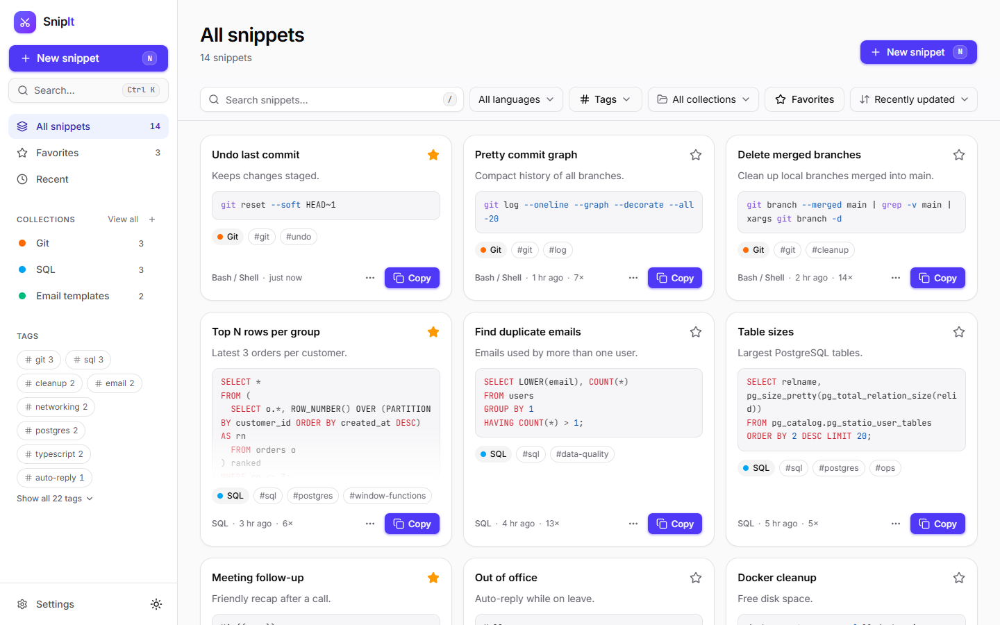
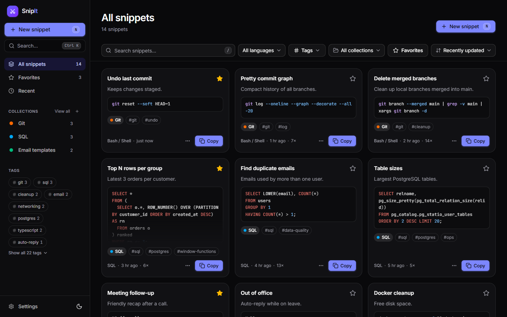
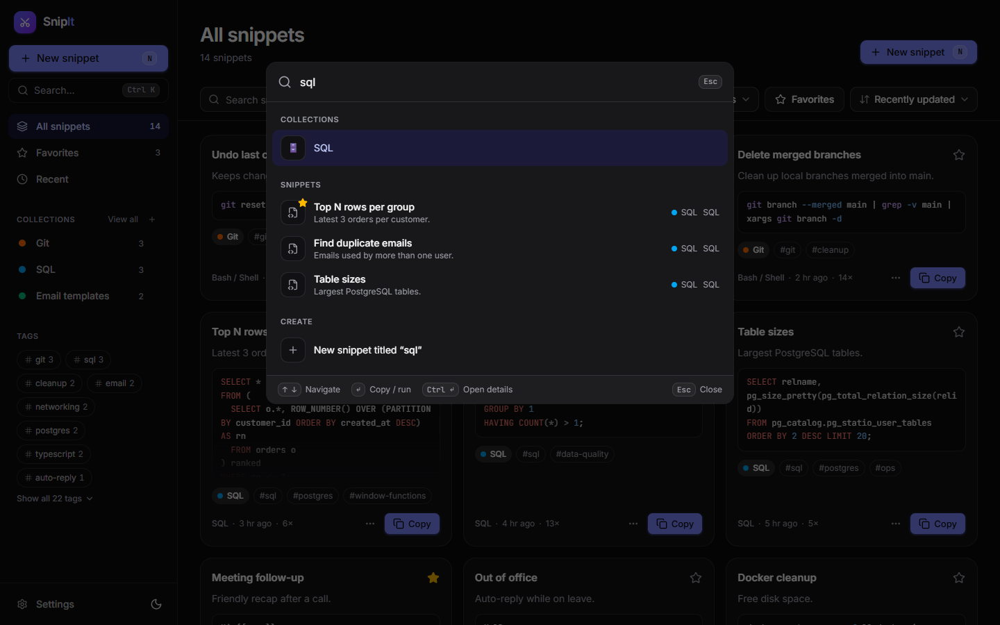
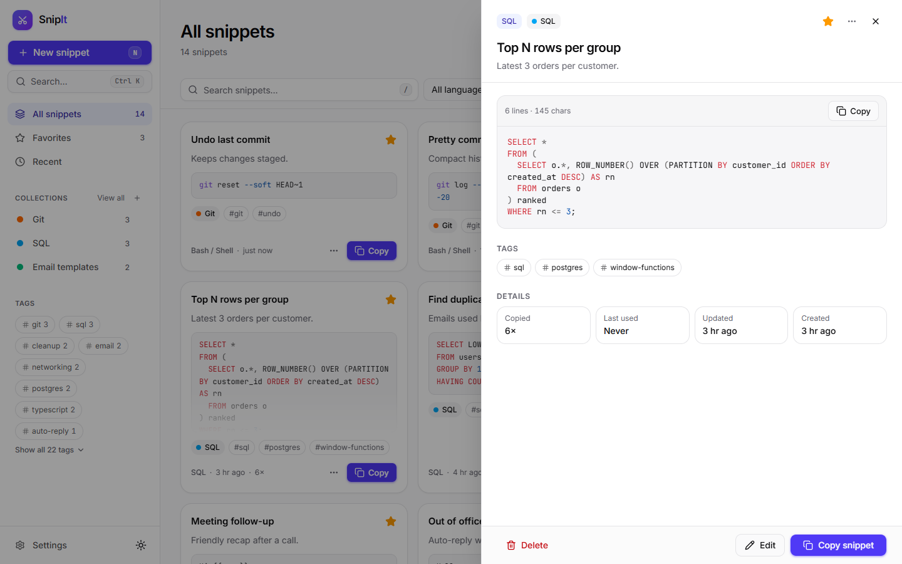
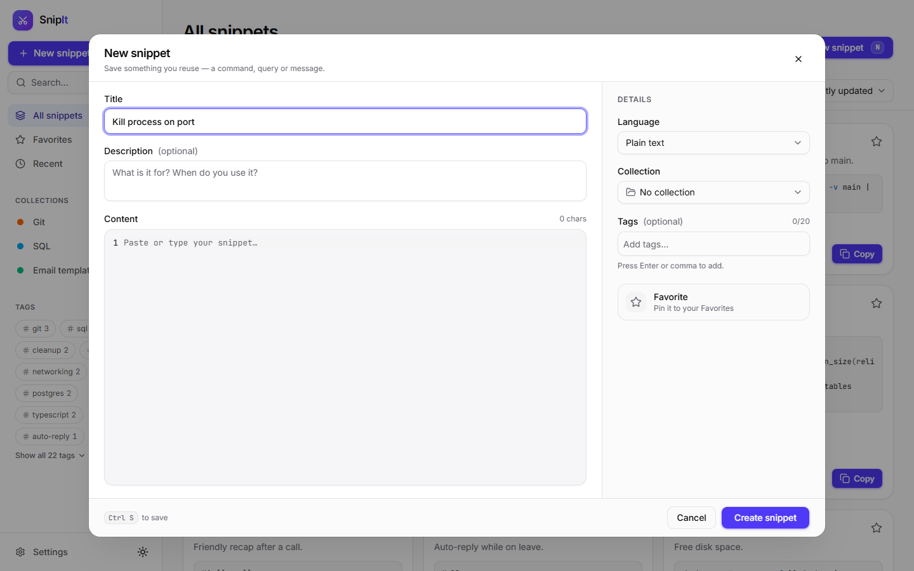
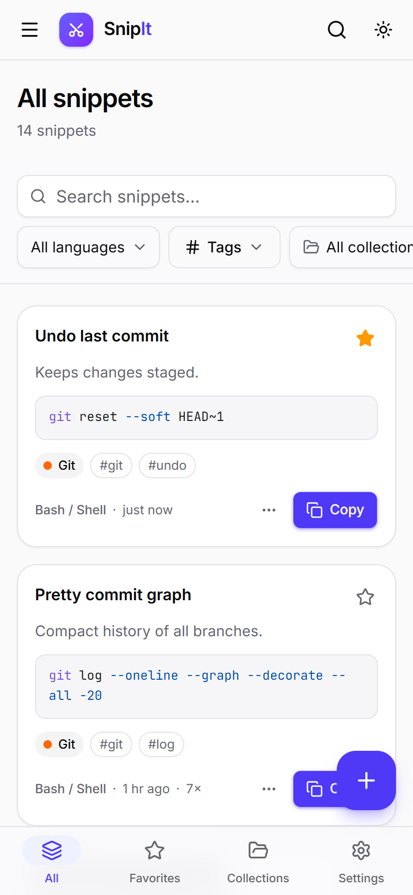
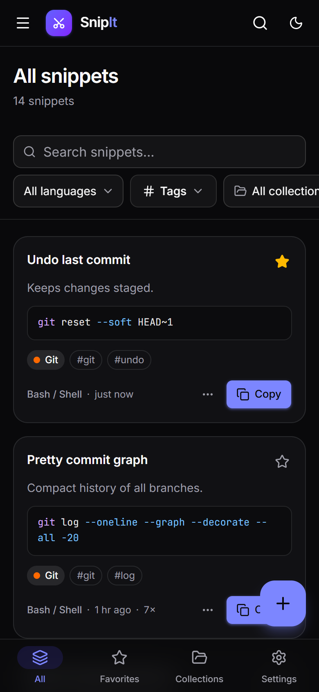

# SnipIt

A fast, local-first snippet manager for the text you reuse every day: shell commands, SQL
queries, code, email templates and canned messages. Find anything in a couple of keystrokes and
copy it with one click. It works offline, installs like an app and keeps your data in your browser.

**Live app:** _coming soon — `https://<your-site>.netlify.app`_



| Dark theme                                         | Command palette (`Ctrl K`)                                   |
| -------------------------------------------------- | ------------------------------------------------------------ |
|    |  |
| **Snippet details**                                | **Editor**                                                   |
|  |  |

<p align="center">
  
  &nbsp;&nbsp;
  
</p>

## Features

- **Save anything:** title, description, content, language, tags, collection and favorite.
  27 languages with syntax highlighting, including plain text and Markdown for messages.
- **One-click copy** from every card, the details view and the command palette, with copy counts.
- **Instant fuzzy search** that tolerates typos and highlights matches, plus filters by language,
  tag, collection and favorites, and sorting. The filters live in the URL, so views can be bookmarked.
- **Command palette** (`Ctrl K` / `⌘ K`) to search, copy and run any action, and **keyboard
  shortcuts** for everything.
- **Collections** with colours and icons, **Favorites** and **Recent** views.
- **Backup and restore:** export the whole library or one collection as JSON. Importing previews
  the changes first and either merges (newest edit wins) or replaces. Files can be dropped
  anywhere on the page.
- **Works offline and installs as an app** on desktop and mobile (PWA), with an in-app
  "new version available" prompt.
- **Your data stays yours:** everything is stored in your browser (IndexedDB). There is no
  account and no tracking. SnipIt asks the browser for persistent storage and reminds you to back up.
- **Comfortable everywhere:** from a 360 px phone to a 27" monitor, in light, dark or system
  theme. It is accessible (WCAG 2.2 AA checked with axe) and honours "reduce motion".

## Keyboard shortcuts

Press `?` in the app for the full list.

| Action                      | Keys                           |
| --------------------------- | ------------------------------ |
| Command palette             | `Ctrl K` / `⌘ K`               |
| Search snippets             | `/`                            |
| New snippet                 | `N`                            |
| Go to All / Favorites / Recent / Collections / Settings | `G` then `A` / `F` / `R` / `C` / `S` |
| Next / previous snippet     | `J` / `K`, or the arrow keys   |
| Focused snippet: open, copy, edit | `Enter` or `O`, `C`, `E` |
| Focused snippet: favorite, duplicate, delete | `F`, `D`, `Del` |
| Save in the editor          | `Ctrl S` or `Ctrl Enter`       |
| Close / clear search        | `Esc`                          |

## Tech stack

All libraries are free and open source.

| Area          | Choice                                                                    |
| ------------- | ------------------------------------------------------------------------- |
| App           | React 19, TypeScript 6 (strict), Vite 8                                   |
| UI            | Tailwind CSS v4, shadcn/ui (Radix UI), lucide-react, Motion, sonner, cmdk |
| Data          | Dexie (IndexedDB), zod schemas shared in `packages/shared`                |
| Search        | Fuse.js                                                                   |
| Editor        | CodeMirror 6 (lazy-loaded, grammars loaded per language)                  |
| Forms         | react-hook-form + zod                                                     |
| PWA           | vite-plugin-pwa (Workbox), `@vite-pwa/assets-generator`                   |
| Quality       | oxlint, Prettier                                                          |
| Hosting       | Netlify                                                                   |

## Getting started

You need **Node.js 22.12 or newer** (see [.nvmrc](.nvmrc)).

```bash
npm install       # install all workspaces
npm run dev       # start the app at http://localhost:5173
```

| Script            | What it does                                                     |
| ----------------- | ---------------------------------------------------------------- |
| `npm run dev`     | Development server with hot reload                               |
| `npm run build`   | Type-check and build for production into `apps/web/dist`         |
| `npm run preview` | Serve the production build locally (http://localhost:4173)       |
| `npm run check`   | Type-check, lint and check formatting (run this before a commit) |
| `npm run format`  | Format all files with Prettier                                   |

> The service worker (offline mode and install) is only active in the production build. Use
> `npm run build` and then `npm run preview` to try it locally.

## Deploying to Netlify

The repository already includes [netlify.toml](netlify.toml), which sets the build command,
publish folder, Node version, SPA routing, security headers (including a strict Content Security
Policy) and cache rules.

1. Push the repository to GitHub.
2. In Netlify choose **Add new site → Import an existing project** and pick the repository.
3. Keep the detected settings (build command `npm run build`, publish directory `apps/web/dist`)
   and click **Deploy**.
4. Optional: rename the site under **Site configuration → Change site name**, then update the
   live link at the top of this README.

Every push to `main` deploys automatically, and pull requests get deploy previews.

## Repository layout

```
apps/web/          React PWA
  src/app/         App shell, routing, layout, theme, motion setup
  src/features/    Feature modules: snippets, collections, commands, backup, pwa, settings, library
  src/components/  Shared UI (shadcn/ui primitives in components/ui)
  src/db/          Dexie database and repositories
  src/hooks/ lib/  Shared hooks and utilities
  vite-plugins/    Build-time bundle checks
packages/shared/   zod schemas, types and language list shared by web (and the Phase 2 API)
docs/              Project plan, decisions and screenshots
netlify.toml       Netlify build, headers and caching
```

## Backup file format

Backups are plain JSON, so you can read them and keep them in version control:

```json
{
  "app": "snipit",
  "version": 1,
  "exportedAt": "2026-10-19T09:30:00.000Z",
  "collections": [{ "id": "…", "name": "Git", "color": "orange", "icon": "🌿", "…": "…" }],
  "snippets": [{ "id": "…", "title": "Undo last commit", "content": "git reset --soft HEAD~1", "…": "…" }]
}
```

Every record is validated when you import it. Damaged records are skipped and reported instead of
failing the whole import.

## Roadmap

- **Phase 1, the local-first PWA:** done (Days 1–3). See [docs/phase-1-frontend.md](docs/phase-1-frontend.md).
- **Phase 2, accounts and multi-device sync:** Node.js, Express, Prisma and PostgreSQL. See
  [docs/phase-2-backend.md](docs/phase-2-backend.md).

The plan overview and decisions are in [docs/README.md](docs/README.md).
